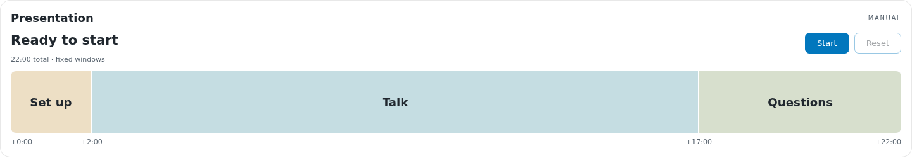
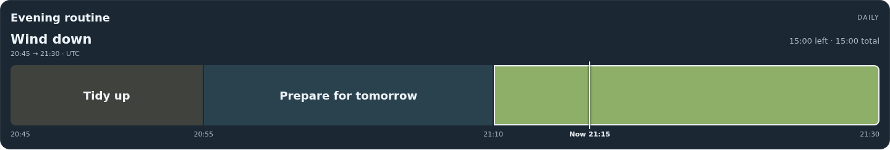

# Time Sequence Card

A Home Assistant dashboard card for routines and timed activities. Define a sequence of phases once and see what is happening now, what comes next, and when each phase ends. Start a presentation manually, or anchor a daily routine to a start time or deadline.





## Highlights

- Start a fixed-duration sequence manually, or repeat one daily from a start or finish time.
- See the current phase, remaining time, boundaries, and a current-time marker.
- Configure phases, colors, sound cues, visibility, and layout with the visual editor or YAML.
- Choose a full or compact display; inspect any phase by touch, mouse, or keyboard.
- Optionally hide a scheduled card outside its window, and add timeline padding without changing the schedule.
- Play optional browser sound cues at phase boundaries.

## Installation

### HACS

[](https://my.home-assistant.io/redirect/hacs_repository/?owner=Uko&repository=time-sequence-card&category=plugin)

1. Open the link above in a browser connected to your Home Assistant instance.
2. In HACS, download **Time Sequence Card**.
3. Reload the browser if the card is not immediately available in the card picker.

Until the card is listed in the default HACS store, add this repository as a **Dashboard** custom repository in HACS:

```text
https://github.com/Uko/time-sequence-card
```

### Manual installation

1. Download `dist/time-sequence-card.js` from the release or repository.
2. Copy it to `<config>/www/time-sequence-card.js`.
3. In **Settings → Dashboards → Resources**, add `/local/time-sequence-card.js` as a **JavaScript module**.
4. Reload the browser and add **Time Sequence Card** from the card picker, or add a Manual card with one of the examples below.

When updating manually, reload the browser and change the resource URL's version query if the old bundle is cached. Do not register a second manual resource if HACS already manages it.

## Quick start: a presentation

```yaml
type: custom:time-sequence-card
title: Presentation
mode: manual
session_id: presentation
phases:
  - label: Set up
    duration: "00:02:00"
    color: "#E6AE47"
  - label: Talk
    duration: "00:15:00"
    color: "#49A9BC"
  - label: Questions
    duration: "00:05:00"
    color: "#8EAF67"
```

Press **Start** to fix the phase boundaries to the current time. Phases advance automatically; there is no pause or skip. Reset clears the session, and a completed sequence can be started again.

The optional `session_id` saves the start in browser local storage for reloads and other tabs on the **same browser origin**. It does not synchronize different devices, browser profiles or Home Assistant URLs. Use a unique ID for each independent sequence. Without it, a page reload resets the run. Changing phase IDs, order or durations invalidates the stored session; changing names or colors does not.

## Daily routine

```yaml
type: custom:time-sequence-card
title: Evening routine
mode: scheduled
anchor:
  at: "21:30"
  edge: end
phases:
  - label: Tidy up
    duration: "00:10:00"
  - label: Prepare for tomorrow
    duration: "00:15:00"
  - label: Wind down
    duration: "00:20:00"
```

With `edge: end`, durations are calculated backwards from the deadline; `edge: start` calculates forwards. Scheduled sequences repeat **every day**. For weekdays, holidays, or other conditions, use Home Assistant's native card visibility rules or a conditional card. An optional built-in window can hide the card outside the sequence, but it does not select weekdays.

## Configuration

Use the visual editor to add, remove and reorder phases and sound cues, adjust layout, and preview calculated times without starting the sequence or playing audio. YAML is also supported.

### Timing and phases

| Parameter | Default | Description |
| --- | --- | --- |
| `type` | Required | Set to `custom:time-sequence-card`. |
| `title` | `Time sequence` | Card title. Hidden in minimalist mode. |
| `mode` | Required | `manual` or `scheduled`. |
| `anchor.at` | Required for scheduled mode | Daily anchor time in `HH:MM`. |
| `anchor.edge` | Required for scheduled mode | `start` calculates forwards; `end` calculates backwards. |
| `phases` | Required | An ordered list of 1–50 timed phases and optional sound cues, with at most 101 entries in total. The total timed duration must be less than 24 hours. |
| `timezone` | Home Assistant time zone | IANA time-zone name for the daily schedule; falls back to the browser until Home Assistant provides its configuration. |
| `session_id` | None | Enable browser-local persistence in manual mode. Use 1–80 letters, digits, underscores or hyphens. |

Each timed entry in `phases` supports:

| Parameter | Default | Description |
| --- | --- | --- |
| `label` | Required | Non-empty phase name. |
| `duration` | Required | Elapsed duration in `HH:MM:SS`, at least one second. |
| `id` | Generated | Unique text identifier. Explicit IDs keep phase identity unambiguous when reordering YAML by hand. |
| `color` | Rotating palette | Phase color in `#RRGGBB` format. |
| `sound` | None | Legacy end-of-phase sound cue; see sound cues below. |

The visual editor assigns stable IDs. Sound-only entries have a `sound` and optional `id`, but no `label` or `duration`.

### Display and visibility

| Parameter | Default | Description |
| --- | --- | --- |
| `minimalist` | `false` | Compact display; manual controls remain available. |
| `height` | `120`, or `80` in minimalist mode | Timeline height in pixels, from 80 to 400. |
| `event_text_scale` | `1` | Event-bar text multiplier from `0.5` to `3`. |
| `show_now` | `true` | Show the current-time marker. |
| `show_remaining` | `true` | Show active-phase countdowns. The next-start countdown remains visible when idle. |
| `padding_before` | `0` | Neutral timeline margin before the sequence, in minutes from 0 to 1440; fractions are allowed. Does not change the schedule. |
| `padding_after` | `0` | Neutral timeline margin after the sequence, in minutes from 0 to 1440; fractions are allowed. Does not change the schedule. |
| `hide_outside_window` | `false` | Hide a scheduled card outside its visibility window. Manual cards and editor previews remain visible. |
| `visibility_before` | `padding_before` | Visibility margin before the sequence, in minutes from 0 to 1440; fractions are allowed. Set `0` explicitly to override padding. |
| `visibility_after` | `padding_after` | Visibility margin after the sequence, in minutes from 0 to 1440; fractions are allowed. Set `0` explicitly to override padding. |

For example, show a scheduled card five minutes before it starts, and keep it visible ten minutes after it ends:

```yaml
hide_outside_window: true
visibility_before: 5
visibility_after: 10
```

The beginning is inclusive and the end exclusive. Home Assistant visibility conditions still apply independently. Tap, hover or focus a phase for its full label, boundaries and duration.

### Sound cues

Add sound-only rows anywhere in the sequence. They do not consume time:

```yaml
phases:
  - sound: /local/sounds/start.mp3
  - label: Work
    duration: "00:15:00"
  - sound: /local/sounds/finish.mp3
```

Place the files under `<config>/www/sounds/`. Only same-origin root-relative paths are supported; external URLs and `media-source://` are not. Sound plays on the browser displaying the card, not a Home Assistant media player. Browser autoplay restrictions, muted devices, background tabs, suspended pages and closed dashboards can prevent playback. The card does not replay missed cues after loading or resuming. Adjacent sound rows play in order and generate a warning; a later cue can interrupt an unfinished group. Up to 101 total phase and sound entries are supported. Existing `sound` properties on timed phases remain supported as end-of-phase cues.

### Language and wording

The current-time word, readiness message and next-start countdown follow Home Assistant's language in English, German, Ukrainian, French, Spanish and Polish; unsupported languages fall back to English. Other controls and editor labels remain English. Optional overrides:

```yaml
translations:
  language: en
  now: "Right now"
  ready_to_start: "Ready when you are"
  starts_in: "Start in {duration}"
```

All keys are optional:

| Parameter | Default | Description |
| --- | --- | --- |
| `translations.language` | Home Assistant language | Override the language used for the supported status text. |
| `translations.now` | Localized text | Current-time word; set to an empty string in YAML for time only. |
| `translations.ready_to_start` | Localized text | Readiness message. |
| `translations.starts_in` | Localized text | Next-start message; must include `{duration}`. |
| `now_label` | Localized text | Legacy current-time word override; `translations.now` takes precedence. |

## Time and limitations

Daily anchors use the Home Assistant time zone unless overridden. Overnight sequences and daylight-saving transitions are supported; nonexistent local anchor times move forward through the gap, and ambiguous times use the earlier occurrence. Durations measure elapsed time. If long sequences overlap during a clock change, the latest-started active sequence takes precedence. Keep the browser clock synchronized.

The card updates from the current time after a suspended page resumes, but it cannot render or play sounds while the browser is closed. It does not run Home Assistant actions.

## Development

Requires Node.js 20+, Python 3 and Playwright's Chromium dependencies:

```sh
npm ci --include=dev
npx playwright install --with-deps chromium
npm run verify
```

The test suite checks types, timing logic and the built bundle in a browser fixture; it is not a live Home Assistant deployment test. Commit the rebuilt `dist/time-sequence-card.js` when changing source.

## License

[MIT](LICENSE).
